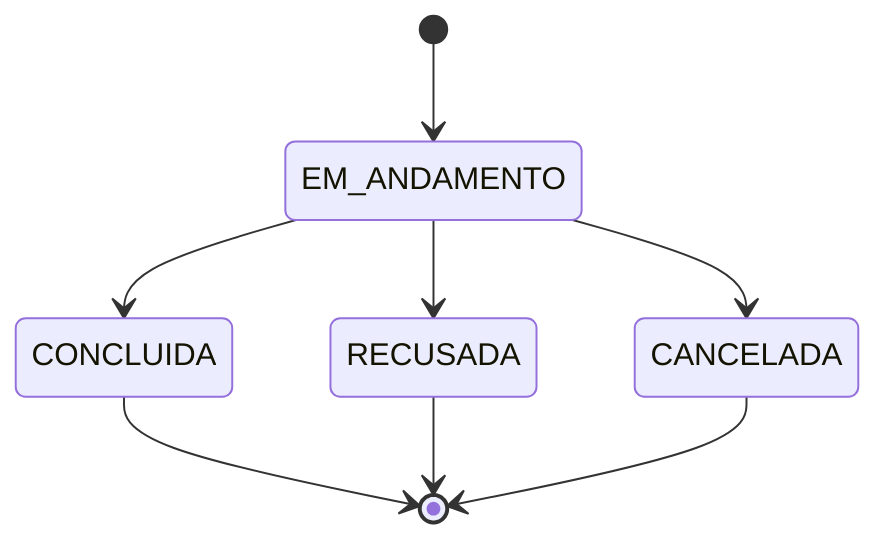

> **Situação (nov/2026):** a resposta do adotante está pronta (modal ao entrar e Minhas adoções). A indicação pelo doador ("Doei") ainda não existe, porque depende do chat; por enquanto as adoções `EM_ANDAMENTO` vêm do seeder de demonstração.

## Como a adoção acontece

Não existe pedido de adoção. O modelo é o de um marketplace:

1. O doador publica o anúncio de adoção.
2. Qualquer pessoa interessada manda mensagem pelo chat do anúncio. É na conversa que as partes se conhecem e combinam a entrega.
3. Depois da entrega, o doador clica em **Doei** e escolhe, entre as pessoas que conversaram com ele naquele anúncio, quem adotou. Isso cria a adoção em `EM_ANDAMENTO`.
4. O adotante recebe a pergunta "Você adotou este pet?" e confirma ou nega. A pergunta aparece num modal ao entrar no sistema; "Depois" só adia até a próxima sessão, e a indicação fica fixa no topo de Minhas adoções até ser respondida.

- **EM_ANDAMENTO** — o doador indicou o adotante e aguarda a confirmação dele.
- **CONCLUIDA** — o adotante confirmou. Estado terminal, e o único que libera avaliação (das duas partes).
- **RECUSADA** — o adotante negou ter adotado. Estado terminal; o doador pode indicar outra pessoa.
- **CANCELADA** — o doador desfez a indicação antes da confirmação (por exemplo, indicou a pessoa errada ou ela não responde). Estado terminal; o doador pode indicar outra pessoa.

A confirmação do adotante é o que dá valor à avaliação: ninguém consegue se dar uma adoção concluída sozinho.

## Sincronia com o anúncio

Adoção e anúncio são máquinas de estado separadas, mas não independentes. As regras que ligam as duas:

| Evento na adoção | Efeito obrigatório no anúncio |
| --- | --- |
| `EM_ANDAMENTO` criada | anúncio permanece `ATIVO` |
| `CONCLUIDA` | anúncio vai para `RESOLVIDO` |
| `RECUSADA` / `CANCELADA` | anúncio continua `ATIVO` e aceita nova indicação |

Restrições que decorrem disso:

- Só um anúncio `ATIVO` do tipo `ADOCAO` aceita indicação de adotante.
- Só pode ser indicado quem conversou com o doador pelo chat daquele anúncio.
- No máximo uma adoção `EM_ANDAMENTO` ou `CONCLUIDA` por anúncio.
- Enquanto houver adoção `EM_ANDAMENTO`, o anúncio não pode ser cancelado: o doador precisa desfazer a indicação antes.
- Uma adoção `CONCLUIDA` nunca volta atrás. Devolução do animal é um anúncio novo, não uma reversão de estado.

Anúncios de `PERDIDO` e `ENCONTRADO` não têm adoção: o autor marca o animal como reencontrado e o anúncio vai direto para `RESOLVIDO`.

## Exclusão de conta

A exclusão de conta cancela automaticamente as adoções em aberto:

- Adotante ou doador exclui a conta: adoções `EM_ANDAMENTO` em que ele participa viram `CANCELADA`.
- `CONCLUIDA` nunca muda, porque libera avaliação e é histórico.

Ver [[Fluxo Status de Anuncio]] para o ciclo de vida do anúncio.

## Por que `Animais` não tem status

O estado do animal é derivado, não armazenado. Guardar uma coluna `Status` em `Animais` criaria uma terceira fonte de verdade sobre o mesmo fato, e nada no banco impediria a combinação impossível de animal marcado como "adotado" com anúncio ainda `ATIVO`.

O estado do animal se lê assim:

| Situação | Como derivar |
| --- | --- |
| Disponível para adoção | existe anúncio `ATIVO` do tipo `ADOCAO` |
| Perdido | existe anúncio `ATIVO` do tipo `PERDIDO` |
| Encontrado, procurando tutor | existe anúncio `ATIVO` do tipo `ENCONTRADO` |
| Adotado | existe adoção `CONCLUIDA` |
| Apenas cadastrado | nenhum anúncio associado |

Ver [[Tipos Anuncio]] para os tipos de anúncio.
