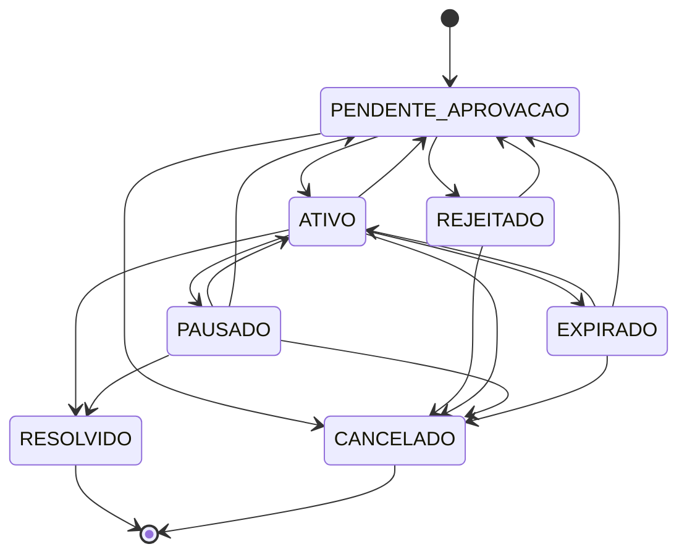

> **Situação (nov/2026):** pausar, retomar, expirar, renovar, marcar como reencontrado, editar (voltando para a moderação) e cancelar estão prontos. Aprovar e rejeitar ainda não têm tela: o painel de moderação está por fazer, e por enquanto os anúncios publicados vêm do seeder.

## Os estados

| Estado | Significado | Quem provoca |
| --- | --- | --- |
| `PENDENTE_APROVACAO` | Enviado, aguardando moderação. | autor |
| `REJEITADO` | Moderação recusou. O motivo fica em `moderations`. | moderador |
| `ATIVO` | Aprovado e publicado, visível no catálogo. | moderador |
| `PAUSADO` | Retirado temporariamente do catálogo pelo autor. | autor |
| `EXPIRADO` | Passou do prazo sem resolução. Sai do catálogo. | sistema |
| `RESOLVIDO` | Adoção concluída (confirmação do "Doei"), ou animal reencontrado ("Reencontrei", só em perdido e encontrado, a partir de `ATIVO` ou `PAUSADO`). | sistema / autor |
| `CANCELADO` | Autor desistiu. Estado terminal. | autor |

## Por que não existe um estado `APROVADO`

A publicação é automática: assim que o moderador aprova, o anúncio já vai ao ar. Um estado `APROVADO` entre `PENDENTE_APROVACAO` e `ATIVO` nunca seria ocupado por nenhuma linha — as duas transições acontecem na mesma operação.

Estado que ninguém ocupa é peso morto no enum e gera dúvida na hora de investigar problema. O registro de que houve aprovação não depende dele: fica em `approved_by`, `approved_at` e na tabela `moderations`.

## Por que não existe um estado `RASCUNHO`

O mesmo argumento vale para rascunho. O cadastro é feito de uma vez, em etapas, e o aviso ao sair protege o que já foi preenchido; o anúncio nasce direto em `PENDENTE_APROVACAO`. Guardar um anúncio pela metade obrigaria quase todas as colunas a aceitar vazio e criaria duas validações (rascunho e envio), um custo que não se paga.

## Pausar não perde a aprovação

Se o autor pausa o anúncio, ele não pode voltar para `PENDENTE_APROVACAO` e cair de novo na fila de moderação.

O fluxo resolve isso porque `PAUSADO` só é alcançável a partir de `ATIVO`, e `PAUSADO` volta para `ATIVO` — nunca para a fila. O mesmo vale para `EXPIRADO`.

## Editar volta para a moderação

Editar é diferente de pausar. Se o autor muda qualquer coisa num anúncio `ATIVO` (texto, dados do animal ou fotos), o anúncio volta para `PENDENTE_APROVACAO`, porque o conteúdo que o moderador aprovou não é mais o mesmo. O mesmo acontece ao editar um anúncio `REJEITADO`: é assim que o autor reenvia. Uma edição que não altera nada mantém o status.

`PAUSADO` e `EXPIRADO` editados também voltam para `PENDENTE_APROVACAO`. Retomar e renovar não passam pela moderação, então sem essa regra daria para pausar, trocar o conteúdo e retomar, publicando algo que ninguém aprovou.

Além disso, o fato de ter sido aprovado não depende do campo de status: fica registrado em `approved_by`, `approved_at` e na tabela `moderations`. Mesmo que o estado atual mude várias vezes, o histórico da moderação permanece.

## Reenvio depois da rejeição

`REJEITADO → PENDENTE_APROVACAO` existe para o autor corrigir o que foi apontado e reenviar. Na prática, o reenvio acontece ao salvar a edição. Cada passagem pela moderação gera uma linha nova em `moderations`, então o histórico de idas e vindas fica preservado.

`REJEITADO → CANCELADO` é a saída de quem desistiu.

## Expiração

`EXPIRADO` evita que anúncio de animal perdido nunca reencontrado fique visível para sempre. O anúncio sai do catálogo mas não é apagado, e o autor pode renovar (`EXPIRADO → ATIVO`).

O prazo é regra de aplicação, não do banco, e depende do tipo: **60 dias** para `ADOCAO` e **30 dias** para `PERDIDO` e `ENCONTRADO`, que ficam desatualizados mais rápido. Ele conta a partir de `published_at`.

- Um comando agendado (`posts:expire`, diário) passa para `EXPIRADO` os anúncios `ATIVO` que venceram. `PAUSADO` não expira: já está fora do catálogo.
- Renovar (`EXPIRADO → ATIVO`) não passa pela moderação, porque o conteúdo aprovado não mudou, e reinicia `published_at`, recomeçando a contagem.

## Cancelar em vez de excluir

O autor nunca apaga um anúncio: o "excluir" da interface leva o anúncio para `CANCELADO`. Ele sai do catálogo, mas o registro e o animal continuam no banco, porque conversas, moderações e o histórico do autor apontam para eles. O anúncio cancelado segue visível para o próprio autor em Meus anúncios, com o selo "Cancelado".

- Pode cancelar a partir de `PENDENTE_APROVACAO`, `REJEITADO`, `ATIVO`, `PAUSADO` e `EXPIRADO`.
- `RESOLVIDO` e `CANCELADO` não podem ser cancelados: são estados finais.
- Com adoção `EM_ANDAMENTO`, o cancelamento é bloqueado até o doador desfazer a indicação. Ver [[Fluxo Status de Adocao]].

## Exclusão de conta

Quando o autor exclui a conta, todo anúncio aberto (`PENDENTE_APROVACAO`, `REJEITADO`, `ATIVO`, `PAUSADO`, `EXPIRADO`) vai direto para `CANCELADO`, inclusive os que normalmente não teriam essa transição. `RESOLVIDO` fica como está, porque é histórico.

Adoções `EM_ANDAMENTO` nesses anúncios viram `CANCELADA`. Ver [[Fluxo Status de Adocao]].

Ver [[Tipos Anuncio]] para os tipos de post e [[Fluxo Status de Adocao]] para o ciclo da adoção.
